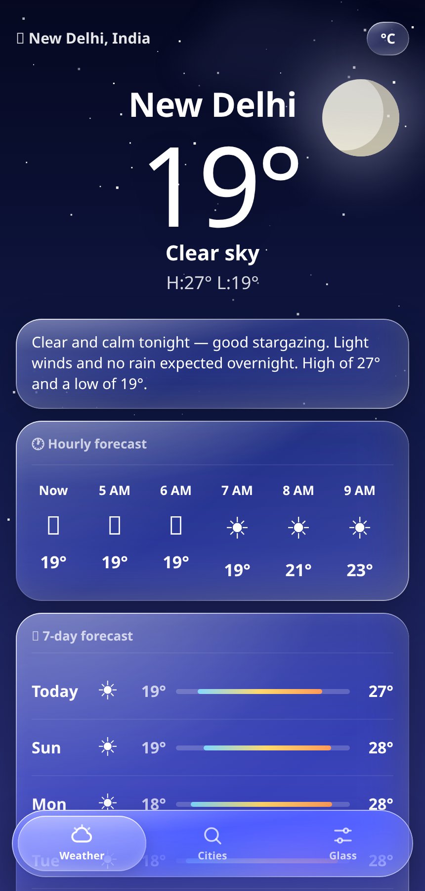
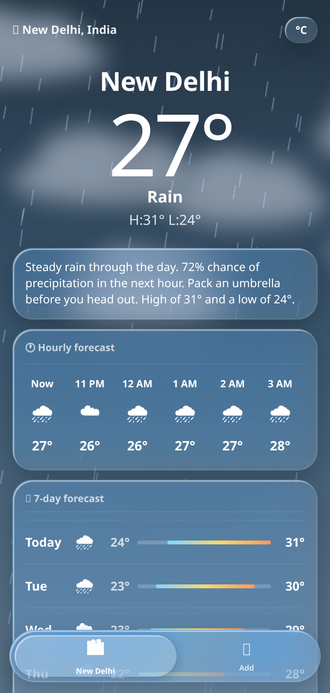
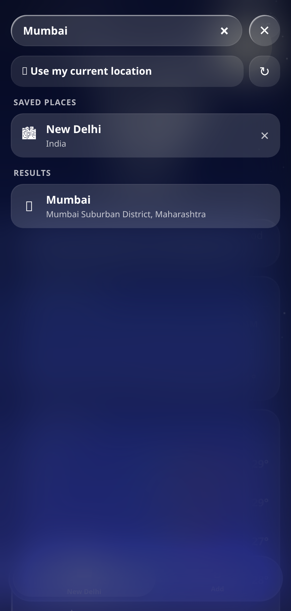

# 🌤 Liquid Weather

A glassy, animated weather app — the exact same design as the original `Liquid_Weather.html` mockup, but fully working: **live forecasts for any city or country in the world**, as a real Android APK.

**No ads. No account. No sign-up. No tracking.** Just open it, allow location (or pick a city), and read the weather.

**Try it right now in your browser:** https://technicalnihilist-lgtm.github.io/liquid-weather/

<p align="center">
  
  
  
</p>

---

## 📲 Install the APK

1. Download **[`LiquidWeather.apk`](LiquidWeather.apk)** (57 KB) from this repo — or from [Releases](../../releases/latest).
2. Tap the file on your phone. Android will say the developer is unknown (the app is self-signed, not from the Play Store) — choose **Install anyway**.
3. Open **Liquid Weather** and allow location when asked.

Works on **Android 6.0 (API 23) and newer**. No Play Store, no Play Services, no dependencies.

Verify your download if you like — the SHA-256 is in [`CHECKSUMS.txt`](CHECKSUMS.txt):

```bash
sha256sum LiquidWeather.apk
# 77a4367f4d53a7a9f3effcc4a567f8d7e1d6aa3c578ea4218c64e74057d30866
```

---

## ✨ What it does

- **Live weather** — current conditions, next 8 hours, and a full 7-day forecast, all real data.
- **Location aware** — asks for your location once, then shows your local weather by name.
- **Anywhere on Earth** — search a city ("Srinagar", "Reykjavik") or a country ("Japan" → Tokyo, Osaka, Sapporo). A built-in list of ~140 cities keeps search working even offline.
- **Up to 5 saved places** in the bottom nav, switch between them instantly.
- **Real metrics** — UV index, wind + gusts, humidity with dew point, feels-like, visibility, pressure.
- **°C / °F** toggle, remembered between launches.
- **The design is intact** — same glass cards, drifting blurred clouds, sun/moon orbs, rain/snow particles, lightning flashes and pill navigation. Conditions now drive the scene, and night gets its own darker palette per condition.

Auto-refreshes every 10 minutes and whenever you come back to the app. Tap the city name to change place or force a refresh.

---

## 🔒 Privacy

- **Location never leaves your device** as anything but a latitude/longitude pair in the weather request. Nothing is stored on a server.
- Saved places and your °C/°F choice live in local storage on the phone.
- No analytics, no ad SDKs, no accounts, no third-party trackers in the APK — you can check: the only network calls in the source are to the weather and geocoding APIs listed below.

Permissions used, and why:

| Permission | Why |
|---|---|
| `INTERNET` | to fetch the forecast |
| `ACCESS_COARSE_LOCATION` / `ACCESS_FINE_LOCATION` | to show weather for where you are. Deny it and the app still works — pick a city instead |

---

## 🌐 Data

Forecasts and city search come from **[Open-Meteo](https://open-meteo.com/)** — free, open, and no API key required. Reverse geocoding (turning coordinates into a city name) uses BigDataCloud's public endpoint, with OpenStreetMap Nominatim as a fallback.

---

## 🛠 Build it yourself

### The web app

Nothing to build — it's one self-contained file:

```bash
open web/index.html        # or just double-click it
```

Serve it over `http://` or `https://` if you want auto-location; browsers block geolocation for files opened directly from disk (the app falls back to a default city and the picker).

### The APK

No Gradle, no Android Studio — just the SDK command-line tools:

```bash
# needs JDK 17 + Android SDK (platforms;android-34, build-tools;34.0.0)
export ANDROID_SDK_ROOT=/path/to/android-sdk
cd android
./build.sh
# -> android/build/LiquidWeather.apk
```

The script runs `aapt2 compile` → `aapt2 link` → `javac` → `d8` → `zipalign` → `apksigner`, then prints the signing certificate. The same script runs in CI on every push, so the APK in this repo can always be rebuilt from the sources in this repo.

The APK is a thin native shell: [`MainActivity.java`](android/java/com/liquidweather/app/MainActivity.java) puts the HTML into a WebView, serves it from an `https` origin (so geolocation and local storage work), and handles the Android runtime location permission. All the UI is [`android/assets/index.html`](android/assets/index.html) — the same file as `web/index.html`.

---

## 📁 Project structure

```
LiquidWeather.apk              signed, installable build
CHECKSUMS.txt                  SHA-256 of the APK + signer fingerprint
web/index.html                 the whole web app (single file)
design/Liquid_Weather.html     original design mockup, kept for reference
android/
  AndroidManifest.xml
  build.sh                     Gradle-free APK build
  java/.../MainActivity.java   WebView shell + location permission
  res/                         launcher icons, theme
  assets/index.html            HTML bundled into the APK
  release.keystore             signing key (see note below)
screenshots/                   images used in this README
.github/workflows/             CI: build APK, deploy web app to Pages
```

---

## 📖 Open source

Everything needed to use, study, change and redistribute this app is in this repository — there are no proprietary blobs, no closed SDKs and no hidden build steps.

- **License:** [MIT](LICENSE) — use it, fork it, ship it, sell it; just keep the copyright notice.
- **Source of truth for the UI:** [`web/index.html`](web/index.html). The Android app is the same file inside a WebView.
- **The design's origin:** [`design/Liquid_Weather.html`](design/Liquid_Weather.html) is the original static mockup this app grew out of, kept unmodified so the design intent stays visible.
- **Reproducible build:** `android/build.sh` (and the CI workflow) turn the committed sources into the committed APK.
- **Contributing:** see [CONTRIBUTING.md](CONTRIBUTING.md). The one hard rule is that the app stays ad-free, account-free and tracker-free.
- **Changes:** see [CHANGELOG.md](CHANGELOG.md).
- **Hosted web version:** served from `web/` by GitHub Pages — https://technicalnihilist-lgtm.github.io/liquid-weather/

**About the signing key:** `android/release.keystore` is included so anyone can rebuild and keep updating the same install. It is a self-signed hobby key (password: `liquidweather`) — since the key is public, anyone could sign an APK claiming to be this app, so don't use this build for anything you'd put money or data behind. For a Play Store release, generate your own keystore and keep it private.

---

## 📄 Credits

- Design and app: Liquid Weather contributors.
- Weather data: [Open-Meteo](https://open-meteo.com/) (CC-BY-4.0 data, free API).
- Reverse geocoding: [BigDataCloud](https://www.bigdatacloud.com/) and [OpenStreetMap](https://www.openstreetmap.org/) contributors (ODbL).

## License

[MIT](LICENSE) © 2026 Liquid Weather contributors
