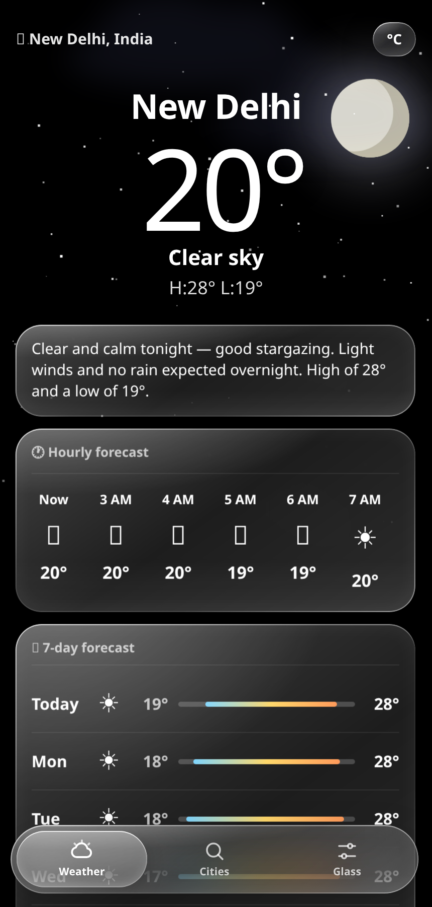
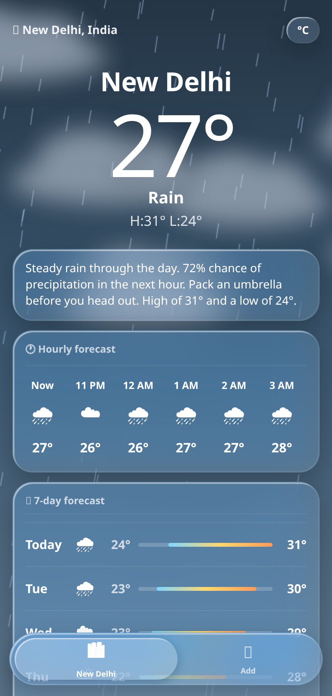
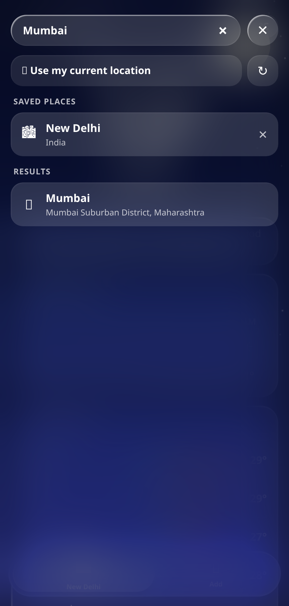
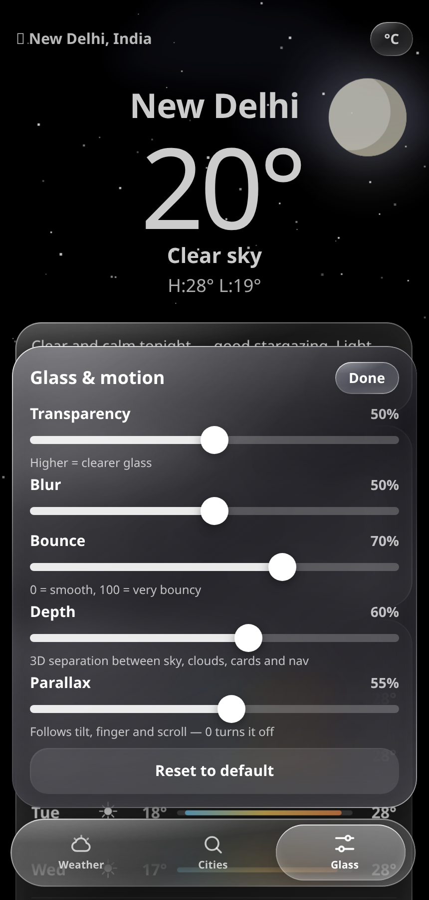

# 🌤 Liquid Weather

A glassy, animated weather app — the exact same design as the original `Liquid_Weather.html` mockup, but fully working: **live forecasts for any city or country in the world**, as a real Android APK.

**No ads. No account. No sign-up. No tracking.** Just open it, allow location (or pick a city), and read the weather.

**Try it right now in your browser:** https://technicalnihilist-lgtm.github.io/liquid-weather/  
**Latest APK:** [v1.11](https://github.com/technicalnihilist-lgtm/liquid-weather/releases/latest)

<p align="center">
  
  
  
</p>
<p align="center">
  
</p>

---

## 📲 Install the APK

1. Download **[`LiquidWeather.apk`](LiquidWeather.apk)** (105 KB) from this repo — or from [Releases](../../releases/latest).
2. Tap the file on your phone. Android will say the developer is unknown (the app is self-signed, not from the Play Store) — choose **Install anyway**.
3. Open **Liquid Weather** and allow location when asked.

Works on **Android 6.0 (API 23) and newer**. No Play Store, no Play Services, no dependencies.

Verify your download if you like — the SHA-256 is in [`CHECKSUMS.txt`](CHECKSUMS.txt):

```bash
sha256sum LiquidWeather.apk
# 9e334cb2c2f511fee829f27d5b2079d85a69e0693ef362b2cd332807290693fb
```

---

## ✨ What it does

- **Live weather** — current conditions, next 8 hours, and a full 7-day forecast, all real data.
- **Location aware** — asks for your location once, then shows your local weather by name.
- **Anywhere on Earth** — search a city ("Srinagar", "Reykjavik") or a country ("Japan" → Tokyo, Osaka, Sapporo). A built-in list of ~140 cities keeps search working even offline.
- **Up to 5 saved places** in the bottom nav, switch between them instantly.
- **Real metrics** — UV index, wind + gusts, humidity with dew point, feels-like, visibility, pressure.
- **°C / °F** toggle, remembered between launches.
- **Glass & motion settings** — tune transparency, blur and bounce to taste, with a reset. Your choices persist.
- **Draggable pill navigation** with Weather / Cities / Glass tabs.
- **4D depth & parallax** — sky, clouds, particles, cards and nav sit at different depths and follow your tilt, finger and scrolling. Tune it with the **Depth** and **Parallax** sliders.
- **Real photo backdrop** — a real photograph of the city you are looking at, from **Wikimedia Commons**, behind the glass; when Commons has no freely licensed photo for that place, a CC-licensed sky for the weather on screen takes its place. Every photo is credited in *Glass & motion*. Only free licences (CC0 / CC BY / CC BY-SA / public domain) are ever used.
- **Real clouds, real sunset** — the number of drifting clouds follows the cloud cover the forecast reports for that city, and the scene switches from day to night at that city's own sunrise and sunset, whose times are shown in the summary card.
- **The design is intact** — same glass cards, drifting blurred clouds, sun/moon orbs, rain/snow particles, lightning flashes and pill navigation. Conditions now drive the scene, and night gets its own darker palette per condition.

Auto-refreshes every 10 minutes and whenever you come back to the app. Tap the city name (or the Cities tab) to change place.

---

## 🔒 Privacy

- **Location never leaves your device** as anything but a latitude/longitude pair in the weather request. Nothing is stored on a server.
- Saved places and your °C/°F choice live in local storage on the phone.
- No analytics, no ad SDKs, no accounts, no third-party trackers in the APK — you can check: the only network calls in the source are to the weather, geocoding and photo APIs listed below.
- The photo backdrop sends the **city name** (never your coordinates) to Wikimedia Commons to look up a licensed photo, and the picture itself is downloaded from `upload.wikimedia.org`. The result is remembered on the phone for three weeks. No photo lookup is made for "My Location".

Permissions used, and why:

| Permission | Why |
|---|---|
| `INTERNET` | to fetch the forecast |
| `ACCESS_COARSE_LOCATION` / `ACCESS_FINE_LOCATION` | to show weather for where you are. Deny it and the app still works — pick a city instead |

---

## 🌐 Data

Forecasts and city search come from **[Open-Meteo](https://open-meteo.com/)** — free, open, and no API key required. Reverse geocoding (turning coordinates into a city name) uses BigDataCloud's public endpoint, with OpenStreetMap Nominatim as a fallback.

Photos come from **[Wikimedia Commons](https://commons.wikimedia.org/)** — the city backdrop is looked up by name through the Commons API, and both it and the weather skies are downloaded from `upload.wikimedia.org`. Only freely licensed files are used, and each one is credited by author and licence inside the app (*Glass & motion → Photos*). The five weather skies are:

| Weather | File | Author | Licence |
|---|---|---|---|
| Partly cloudy | Cirrus-cumulus clouds in the sky 2 | Rise DHMN | CC BY 4.0 |
| Fog / overcast | Stratus cloud near Mithapukur, Rangpur (1) | Muntashir.islam | CC BY-SA 4.0 |
| Rain | Storm clouds coming in over Gåseberg 2 | W.carter | CC0 |
| Thunderstorm | Cloudscape santhosh | Santhoshj | CC BY 3.0 |
| Snow | Shaheed Island, Andaman Sea, Overcast sky | Vyacheslav Argenberg | CC BY 4.0 |

---

## 🛠 Build it yourself

### The web app

Nothing to build — it's one self-contained file:

```bash
open web/index.html        # or just double-click it
```

Serve it over `http://` or `https://` if you want auto-location; browsers block geolocation for files opened directly from disk (the app falls back to a default city and the picker).

### The APK

No Gradle, no Android Studio — just the SDK command-line tools:

```bash
# needs JDK 17 + Android SDK (platforms;android-34, build-tools;34.0.0)
export ANDROID_SDK_ROOT=/path/to/android-sdk
cd android
./build.sh
# -> android/build/LiquidWeather.apk
```

The script runs `aapt2 compile` → `aapt2 link` → `javac` → `d8` → `zipalign` → `apksigner`, then prints the signing certificate. The same script runs in CI on every push, so the APK in this repo can always be rebuilt from the sources in this repo.

The APK is a thin native shell: [`MainActivity.java`](android/java/com/liquidweather/app/MainActivity.java) puts the HTML into a WebView, serves it from an `https` origin (so geolocation and local storage work), and handles the Android runtime location permission. All the UI is [`android/assets/index.html`](android/assets/index.html) — the same file as `web/index.html`.

---

## 📁 Project structure

```
LiquidWeather.apk              signed, installable build
CHECKSUMS.txt                  SHA-256 of the APK + signer fingerprint
web/index.html                 the whole web app (single file)
design/Liquid_Weather.html     original design mockup, kept for reference
android/
  AndroidManifest.xml
  build.sh                     Gradle-free APK build
  java/.../MainActivity.java   WebView shell + location permission
  res/                         launcher icons, theme
  assets/index.html            HTML bundled into the APK
  release.keystore             signing key (see note below)
screenshots/                   images used in this README
.github/workflows/             CI: build APK, deploy web app to Pages
```

---

## 📖 Open source

Everything needed to use, study, change and redistribute this app is in this repository — there are no proprietary blobs, no closed SDKs and no hidden build steps.

- **License:** [MIT](LICENSE) — use it, fork it, ship it, sell it; just keep the copyright notice.
- **Source of truth for the UI:** [`web/index.html`](web/index.html). The Android app is the same file inside a WebView.
- **The design's origin:** [`design/Liquid_Weather.html`](design/Liquid_Weather.html) is the original static mockup this app grew out of, kept unmodified so the design intent stays visible.
- **Buildable from source:** `android/build.sh` (and the CI workflow) turn the committed sources into the shipped APK — no hidden steps, no prebuilt blobs. Builds aren't bit-identical because zip entries carry timestamps, but the code inside is exactly this tree.
- **Contributing:** see [CONTRIBUTING.md](CONTRIBUTING.md). The one hard rule is that the app stays ad-free, account-free and tracker-free.
- **Changes:** see [CHANGELOG.md](CHANGELOG.md).
- **Hosted web version:** served from `web/` by GitHub Pages — https://technicalnihilist-lgtm.github.io/liquid-weather/
- **Store submission:** ready-to-paste listing values, descriptions and direct screenshot links are in [STORE.md](STORE.md).
- **Maintenance programme:** the November 2026 stability/performance passes are documented in [MAINTENANCE.md](MAINTENANCE.md).

**About the signing key:** `android/release.keystore` is included so anyone can rebuild and keep updating the same install. It is a self-signed hobby key (password: `liquidweather`) — since the key is public, anyone could sign an APK claiming to be this app, so don't use this build for anything you'd put money or data behind. For a Play Store release, generate your own keystore and keep it private.

---

## 📄 Credits

- Design and app: Liquid Weather contributors.
- Weather data: [Open-Meteo](https://open-meteo.com/) (CC-BY-4.0 data, free API).
- Reverse geocoding: [BigDataCloud](https://www.bigdatacloud.com/) and [OpenStreetMap](https://www.openstreetmap.org/) contributors (ODbL).

## License

[MIT](LICENSE) © 2026 Liquid Weather contributors

---

## ⭐ Like this work? Give it a star

If you like this app and our work, please **star this repository** ⭐ and **[follow technicalnihilist-lgtm on GitHub](https://github.com/technicalnihilist-lgtm)**. If our work isn't for you, that's completely fine — the choice is yours. Thank you for stopping by!

<details>
<summary><b>🌍 Same message in 32 languages (A–Z + Indian languages)</b></summary>

- **A — Arabic** (العربية): ⭐ إذا أعجبك هذا التطبيق وعملنا، فيرجى منح المستودع نجمة ومتابعتنا. وإذا لم يعجبك عملنا، فلا مشكلة على الإطلاق — القرار قرارك. شكرًا لزيارتك!
- **B — Bengali** (বাংলা): ⭐ যদি আপনার এই অ্যাপ এবং আমাদের কাজ ভালো লাগে, তবে অনুগ্রহ করে রিপোজিটরিটিকে একটি স্টার দিন এবং আমাদের ফলো করুন। আমাদের কাজ যদি আপনার পছন্দ না হয়, তাতেও কোনো সমস্যা নেই — সিদ্ধান্ত আপনার। আমাদের পেজে আসার জন্য ধন্যবাদ!
- **C — Chinese** (中文): ⭐ 如果你喜欢这个应用和我们的作品，请给仓库点个星标并关注我们。如果我们的作品不适合你，也完全没关系——选择权在你。感谢你的到访！
- **D — Dutch** (Nederlands): ⭐ Vind je deze app en ons werk leuk? Geef de repository dan een ster en volg ons. Vind je ons werk niets, dan is dat helemaal prima — de keuze is aan jou. Bedankt voor je bezoek!
- **E — English** (English): ⭐ If you like this app and our work, please give the repository a star and follow us. If our work isn't for you, that's completely fine — the choice is yours. Thank you for stopping by!
- **F — French** (Français): ⭐ Si cette application et notre travail vous plaisent, mettez une étoile au dépôt et suivez-nous. Si notre travail n'est pas pour vous, aucun souci — c'est votre choix. Merci de votre visite !
- **G — German** (Deutsch): ⭐ Wenn dir diese App und unsere Arbeit gefallen, gib dem Repository einen Stern und folge uns. Wenn unsere Arbeit nichts für dich ist, ist das völlig in Ordnung — die Wahl liegt bei dir. Danke fürs Vorbeischauen!
- **H — Hindi** (हिन्दी): ⭐ अगर आपको यह ऐप और हमारा काम पसंद है, तो कृपया रिपॉजिटरी को स्टार दें और हमें फॉलो करें। अगर हमारा काम आपके लिए नहीं है, तो भी कोई बात नहीं — यह पूरी तरह आपकी मर्ज़ी है। यहाँ आने के लिए आपका धन्यवाद!
- **I — Indonesian** (Bahasa Indonesia): ⭐ Jika kamu suka aplikasi ini dan karya kami, beri bintang pada repositori ini dan ikuti kami. Kalau karya kami bukan untukmu, tidak masalah sama sekali — itu pilihanmu. Terima kasih sudah mampir!
- **J — Japanese** (日本語): ⭐ このアプリと私たちの仕事が気に入ったら、リポジトリにスターを付けてフォローしてください。合わない場合はまったく問題ありません — 選ぶのはあなたです。お越しいただきありがとうございます！
- **K — Korean** (한국어): ⭐ 이 앱과 저희 작업이 마음에 드신다면 저장소에 스타를 눌러 주시고 팔로우해 주세요. 저희 작업이 맞지 않으셔도 전혀 괜찮습니다 — 선택은 여러분의 몫입니다. 방문해 주셔서 감사합니다!
- **L — Lithuanian** (Lietuvių): ⭐ Jei tau patinka ši programa ir mūsų darbas, duok saugyklai žvaigždutę ir sek mus. Jei mūsų darbas ne tau, viskas gerai — pasirinkimas tavo. Ačiū, kad užsukai!
- **M — Malayalam** (മലയാളം): ⭐ നിങ്ങൾക്ക് ഈ ആപ്പും ഞങ്ങളുടെ പ്രവർത്തനവും ഇഷ്ടപ്പെട്ടെങ്കിൽ, ദയവായി റെപ്പോസിറ്ററിക്ക് ഒരു സ്റ്റാർ നൽകുകയും ഞങ്ങളെ ഫോളോ ചെയ്യുകയും ചെയ്യുക. ഞങ്ങളുടെ പ്രവർത്തനം നിങ്ങൾക്ക് അനുയോജ്യമല്ലെങ്കിൽ, അതും തികച്ചും കുഴപ്പമില്ല — തീരുമാനം നിങ്ങളുടേതാണ്. ഇവിടെ വന്നതിന് നന്ദി!
- **N — Nepali** (नेपाली): ⭐ यदि तपाईंलाई यो एप र हाम्रो काम मन पर्‍यो भने, कृपया रिपोजिटरीलाई स्टार दिनुहोस् र हामीलाई फलो गर्नुहोस्। यदि हाम्रो काम तपाईंलाई मन पर्दैन भने, पनि ठीकै छ — यो तपाईंको इच्छा हो। यहाँ आउनुभएकोमा धन्यवाद!
- **O — Odia** (ଓଡ଼ିଆ): ⭐ ଯଦି ଆପଣଙ୍କୁ ଏହି ଆପ୍ ଏବଂ ଆମର କାମ ଭଲ ଲାଗୁଛି, ତେବେ ଦୟାକରି ରିପୋଜିଟୋରୀକୁ ଗୋଟିଏ ଷ୍ଟାର୍ ଦିଅନ୍ତୁ ଏବଂ ଆମକୁ ଫଲୋ କରନ୍ତୁ। ଯଦି ଆମର କାମ ଆପଣଙ୍କ ପାଇଁ ନୁହେଁ, ତେବେ କିଛି ଅସୁବିଧା ନାହିଁ — ପସନ୍ଦ ଆପଣଙ୍କର। ଆମ ପାଖକୁ ଆସିଥିବାରୁ ଧନ୍ୟବାଦ!
- **P — Polish** (Polski): ⭐ Jeśli podoba Ci się ta aplikacja i nasza praca, daj repozytorium gwiazdkę i obserwuj nas. Jeśli nasza praca nie jest dla Ciebie, to zupełnie w porządku — wybór należy do Ciebie. Dziękujemy za odwiedziny!
- **Q — Quechua** (Runa Simi): ⭐ Kay app, ñuqaykup ruwasqanchikpas gustasunki chayqa, repositorioman huk estrella churay, ñuqaykutapas qatipayku. Mana gustasunki chayqa, allinmi — qampa akllayki. Hamusqaykimanta sulpayki!
- **R — Russian** (Русский): ⭐ Если вам нравится это приложение и наша работа, поставьте звёздочку репозиторию и подпишитесь на нас. Если наша работа не для вас — это совершенно нормально, выбор за вами. Спасибо, что заглянули!
- **S — Spanish** (Español): ⭐ Si te gusta esta app y nuestro trabajo, dale una estrella al repositorio y síguenos. Si nuestro trabajo no es para ti, no pasa nada — la decisión es tuya. ¡Gracias por pasarte!
- **T — Tamil** (தமிழ்): ⭐ உங்களுக்கு இந்த ஆப்பும் எங்க வேலையும் பிடிச்சிருந்தா, தயவுசெஞ்சு இந்த ரெபாசிட்டரிக்கு ஒரு ஸ்டார் குடுத்து, எங்களை ஃபாலோ பண்ணுங்க. எங்க வேலை உங்களுக்கு செட் ஆகலைன்னாலும் பரவாயில்லை — அது உங்க விருப்பம். இங்கே வந்ததுக்கு நன்றி!
- **U — Urdu** (اردو): ⭐ اگر آپ کو یہ ایپ اور ہمارا کام پسند آئے تو براہ کرم ریپازٹری کو سٹار دیں اور ہمیں فالو کریں۔ اگر ہمارا کام آپ کے لیے نہیں ہے، تو یہ بالکل ٹھیک ہے — انتخاب آپ کا ہے۔ یہاں تشریف لانے کا شکریہ!
- **V — Vietnamese** (Tiếng Việt): ⭐ Nếu bạn thích ứng dụng này và công việc của chúng tôi, hãy tặng kho lưu trữ một ngôi sao và theo dõi chúng tôi. Nếu công việc của chúng tôi không phù hợp với bạn, điều đó hoàn toàn ổn — lựa chọn là của bạn. Cảm ơn bạn đã ghé qua!
- **W — Welsh** (Cymraeg): ⭐ Os ydych chi'n hoffi'r ap hwn a'n gwaith, rhowch seren i'r storfa a dilynwch ni. Os nad yw ein gwaith ar eich cyfer, mae hynny'n hollol iawn — chi sydd i benderfynu. Diolch am alw heibio!
- **X — Xhosa** (isiXhosa): ⭐ Ukuba uyayithanda le app nomsebenzi wethu, nika irepo inkwenkwezi kwaye usilandele. Ukuba umsebenzi wethu awukufanelanga, akukho ngxaki — lukhetho lwakho. Enkosi ngokutyelela!
- **Y — Yoruba** (Yorùbá): ⭐ Bí app yìí àti iṣẹ́ wa bá wù ọ́, jọ̀wọ́ fún àkójọpọ̀ náà ní ìràwọ̀ kí o sì tẹ̀lé wa. Bí iṣẹ́ wa kò bá yẹ ọ́, kò séwu — ìwọ ni ó yàn. Ẹ ṣé fún wíwá!
- **Z — Zulu** (isiZulu): ⭐ Uma uthanda le app nomsebenzi wethu, nikeza isitoreji inkanyezi bese usilandela. Uma umsebenzi wethu ungakufanele, akunankinga — wukukhetha kwakho. Siyabonga ngokuvakasha!

**More Indian languages**

- **Assamese** (অসমীয়া): ⭐ যদি আপুনি এই এপটো আৰু আমাৰ কাম ভাল পায়, তেন্তে অনুগ্ৰহ কৰি ৰিপজিটৰীটোক এটা ষ্টাৰ দিয়ক আৰু আমাক ফ'ল' কৰক। যদি আমাৰ কাম আপোনাৰ বাবে নহয়, তেন্তে সেয়া একেবাৰে ঠিক আছে — সিদ্ধান্তটো আপোনাৰ। আমাৰ ইয়ালৈ অহাৰ বাবে ধন্যবাদ!
- **Gujarati** (ગુજરાતી): ⭐ જો તમને આ એપ અને અમારું કામ ગમતું હોય, તો પ્લીઝ રિપોઝિટરીને સ્ટાર આપો અને અમને ફોલો કરો. જો અમારું કામ તમને ન ગમતું હોય, તો તે પણ બરાબર છે — પસંદગી તમારી છે. અહીં આવવા બદલ આભાર!
- **Kannada** (ಕನ್ನಡ): ⭐ ನಿಮಗೆ ಈ ಆ್ಯಪ್ ಮತ್ತು ನಮ್ಮ ಕೆಲಸ ಇಷ್ಟವಾದರೆ, ದಯವಿಟ್ಟು ರೆಪೊಸಿಟರಿಗೆ ಸ್ಟಾರ್ ಕೊಡಿ ಮತ್ತು ನಮ್ಮನ್ನು ಫಾಲೋ ಮಾಡಿ. ನಮ್ಮ ಕೆಲಸ ನಿಮಗೆ ಸರಿಹೊಂದದಿದ್ದರೆ, ಅದೂ ಪರವಾಗಿಲ್ಲ — ಆಯ್ಕೆ ನಿಮ್ಮದು. ಭೇಟಿ ನೀಡಿದ್ದಕ್ಕೆ ಧನ್ಯವಾದಗಳು!
- **Marathi** (मराठी): ⭐ जर तुम्हाला हे ॲप आणि आमचं काम आवडलं असेल, तर कृपया रिपॉझिटरीला स्टार द्या आणि आम्हाला फॉलो करा. जर आमचं काम तुम्हाला आवडत नसेल, तर काही हरकत नाही — ती तुमची निवड आहे. इथे आल्याबद्दल धन्यवाद!
- **Punjabi** (ਪੰਜਾਬੀ): ⭐ ਜੇ ਤੁਹਾਨੂੰ ਇਹ ਐਪ ਅਤੇ ਸਾਡਾ ਕੰਮ ਪਸੰਦ ਹੈ, ਤਾਂ ਕਿਰਪਾ ਕਰਕੇ ਰਿਪੋਜ਼ਟਰੀ ਨੂੰ ਸਟਾਰ ਦਿਓ ਅਤੇ ਸਾਨੂੰ ਫਾਲੋ ਕਰੋ। ਜੇ ਸਾਡਾ ਕੰਮ ਤੁਹਾਡੇ ਲਈ ਨਹੀਂ ਹੈ, ਤਾਂ ਕੋਈ ਗੱਲ ਨਹੀਂ — ਚੋਣ ਤੁਹਾਡੀ ਹੈ। ਸਾਡੇ ਪੇਜ 'ਤੇ ਆਉਣ ਲਈ ਧੰਨਵਾਦ!
- **Telugu** (తెలుగు): ⭐ మీకు ఈ యాప్, మా పని నచ్చితే, దయచేసి రిపోజిటరీకి ఒక స్టార్ ఇచ్చి మమ్మల్ని ఫాలో అవ్వండి. ఒకవేళ మా పని మీకు నచ్చకపోతే, పర్వాలేదు — అది మీ ఇష్టం. మమ్మల్ని సందర్శించినందుకు ధన్యవాదాలు!

</details>
