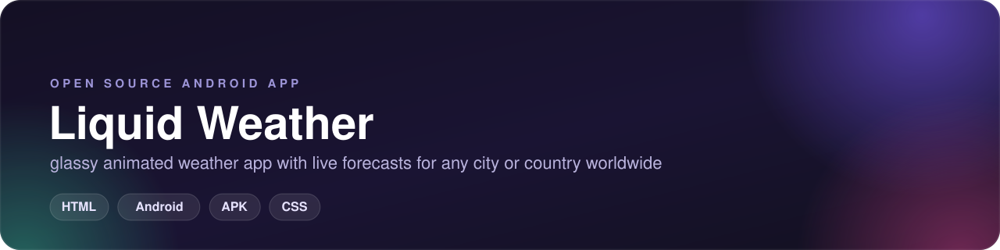

<div align="center">




<a href="https://github.com/technicalnihilist-lgtm/liquid-weather/stargazers"></a>&nbsp;<a href="https://github.com/technicalnihilist-lgtm/liquid-weather/network/members"></a>

<a href="https://github.com/technicalnihilist-lgtm/liquid-weather/releases/latest"></a> <a href="https://technicalnihilist-lgtm.github.io/liquid-weather/"></a>

<b>Support the work</b>

  

<sub>Donations aren't live yet — Paytm, UPI, PayPal and Buy&nbsp;Me&nbsp;a&nbsp;Coffee all show <b>coming soon</b>. Until then, a ⭐ star is the best support.</sub>

<a href="https://github.com/technicalnihilist-lgtm/liquid-weather/releases/latest"></a>  <a href="https://technicalnihilist-lgtm.github.io/liquid-weather/"></a>

</div>

---

## 📲 Install the APK

**Latest APK:** [v1.15](https://github.com/technicalnihilist-lgtm/liquid-weather/releases/latest)

1. Download **[`LiquidWeather.apk`](LiquidWeather.apk)** (109 KB) from this repo — or from [Releases](../../releases/latest).
2. Tap the file on your phone. Android will say the developer is unknown (the app is self-signed, not from the Play Store) — choose **Install anyway**.
3. Open **Liquid Weather** and allow location when asked.

Works on **Android 6.0 (API 23) and newer**. No Play Store, no Play Services, no dependencies.

Verify your download if you like — the SHA-256 is in [`CHECKSUMS.txt`](CHECKSUMS.txt):

```bash
sha256sum LiquidWeather.apk
## ✨ What it does

- **Live weather** — current conditions, next 8 hours, and a full 7-day forecast, all real data.
- **Location aware** — asks for your location once, then shows your local weather by name.
- **Anywhere on Earth** — search a city ("Srinagar", "Reykjavik") or a country ("Japan" → Tokyo, Osaka, Sapporo). A built-in list of ~140 cities keeps search working even offline.
- **Up to 5 saved places** in the bottom nav, switch between them instantly.
- **Real metrics** — UV index, wind + gusts, humidity with dew point, feels-like, visibility, pressure.
- **°C / °F** toggle, remembered between launches.
- **Glass & motion settings** — tune transparency, blur and bounce to taste, with a reset. Your choices persist.
- **Draggable pill navigation** with Weather / Cities / Glass tabs.
- **4D depth & parallax** — sky, clouds, particles, cards and nav sit at different depths and follow your tilt, finger and scrolling. Tune it with the **Depth** and **Parallax** sliders.
- **Real photo backdrop** — a real photograph of the city you are looking at, from **Wikimedia Commons**, behind the glass; when Commons has no freely licensed photo for that place, a CC-licensed sky for the weather on screen takes its place. Every photo is credited in *Glass & motion*. Only free licences (CC0 / CC BY / CC BY-SA / public domain) are ever used.
- **Real clouds, real sunset** — the number of drifting clouds follows the cloud cover the forecast reports for that city, and the scene switches from day to night at that city's own sunrise and sunset, whose times are shown in the summary card.
- **The design is intact** — same glass cards, drifting blurred clouds, sun/moon orbs, rain/snow particles, lightning flashes and pill navigation. Conditions now drive the scene, and night gets its own darker palette per condition.

Auto-refreshes every 10 minutes and whenever you come back to the app. Tap the city name (or the Cities tab) to change place.

---

## 🔒 Privacy

- **Location never leaves your device** as anything but a latitude/longitude pair in the weather request. Nothing is stored on a server.
- Saved places and your °C/°F choice live in local storage on the phone.
- No analytics, no ad SDKs, no accounts, no third-party trackers in the APK — you can check: the only network calls in the source are to the weather, geocoding and photo APIs listed below.
- The photo backdrop sends the **city name** (never your coordinates) to Wikimedia Commons to look up a licensed photo, and the picture itself is downloaded from `upload.wikimedia.org`. The result is remembered on the phone for three weeks. No photo lookup is made for "My Location".

Permissions used, and why:

| Permission | Why |
|---|---|
| `INTERNET` | to fetch the forecast |
| `ACCESS_COARSE_LOCATION` / `ACCESS_FINE_LOCATION` | to show weather for where you are. Deny it and the app still works — pick a city instead |

---

## 🌐 Data

Forecasts and city search come from **[Open-Meteo](https://open-meteo.com/)** — free, open, and no API key required. Reverse geocoding (turning coordinates into a city name) uses BigDataCloud's public endpoint, with OpenStreetMap Nominatim as a fallback.

Photos come from **[Wikimedia Commons](https://commons.wikimedia.org/)** — the city backdrop is looked up by name through the Commons API, and both it and the weather skies are downloaded from `upload.wikimedia.org`. Only freely licensed files are used, and each one is credited by author and licence inside the app (*Glass & motion → Photos*). The five weather skies are:

| Weather | File | Author | Licence |
|---|---|---|---|
| Partly cloudy | Cirrus-cumulus clouds in the sky 2 | Rise DHMN | CC BY 4.0 |
| Fog / overcast | Stratus cloud near Mithapukur, Rangpur (1) | Muntashir.islam | CC BY-SA 4.0 |
| Rain | Storm clouds coming in over Gåseberg 2 | W.carter | CC0 |
| Thunderstorm | Cloudscape santhosh | Santhoshj | CC BY 3.0 |
| Snow | Shaheed Island, Andaman Sea, Overcast sky | Vyacheslav Argenberg | CC BY 4.0 |

---

## 🛠 Build it yourself

### The web app

Nothing to build — it's one self-contained file:

```bash
open web/index.html        # or just double-click it
```

Serve it over `http://` or `https://` if you want auto-location; browsers block geolocation for files opened directly from disk (the app falls back to a default city and the picker).

### The APK

No Gradle, no Android Studio — just the SDK command-line tools:

```bash
## 📁 Project structure

```
LiquidWeather.apk              signed, installable build
CHECKSUMS.txt                  SHA-256 of the APK + signer fingerprint
web/index.html                 the whole web app (single file)
design/Liquid_Weather.html     original design mockup, kept for reference
android/
  AndroidManifest.xml
  build.sh                     Gradle-free APK build
  java/.../MainActivity.java   WebView shell + location permission
  res/                         launcher icons, theme
  assets/index.html            HTML bundled into the APK
  release.keystore             signing key (see note below)
screenshots/                   images used in this README
.github/workflows/             CI: build APK, deploy web app to Pages
```

---

## 📖 Open source

Everything needed to use, study, change and redistribute this app is in this repository — there are no proprietary blobs, no closed SDKs and no hidden build steps.

- **License:** [MIT](LICENSE) — use it, fork it, ship it, sell it; just keep the copyright notice.
- **Source of truth for the UI:** [`web/index.html`](web/index.html). The Android app is the same file inside a WebView.
- **The design's origin:** [`design/Liquid_Weather.html`](design/Liquid_Weather.html) is the original static mockup this app grew out of, kept unmodified so the design intent stays visible.
- **Buildable from source:** `android/build.sh` (and the CI workflow) turn the committed sources into the shipped APK — no hidden steps, no prebuilt blobs. Builds aren't bit-identical because zip entries carry timestamps, but the code inside is exactly this tree.
- **Contributing:** see [CONTRIBUTING.md](CONTRIBUTING.md). The one hard rule is that the app stays ad-free, account-free and tracker-free.
- **Changes:** see [CHANGELOG.md](CHANGELOG.md).
- **Hosted web version:** served from `web/` by GitHub Pages — https://technicalnihilist-lgtm.github.io/liquid-weather/
- **Store submission:** ready-to-paste listing values, descriptions and direct screenshot links are in [STORE.md](STORE.md).
- **Maintenance programme:** the November 2026 stability/performance passes are documented in [MAINTENANCE.md](MAINTENANCE.md).

**About the signing key:** `android/release.keystore` is included so anyone can rebuild and keep updating the same install. It is a self-signed hobby key (password: `liquidweather`) — since the key is public, anyone could sign an APK claiming to be this app, so don't use this build for anything you'd put money or data behind. For a Play Store release, generate your own keystore and keep it private.

---

## 📄 Credits

- Design and app: Liquid Weather contributors.
- Weather data: [Open-Meteo](https://open-meteo.com/) (CC-BY-4.0 data, free API).
- Reverse geocoding: [BigDataCloud](https://www.bigdatacloud.com/) and [OpenStreetMap](https://www.openstreetmap.org/) contributors (ODbL).

## License

[MIT](LICENSE) © 2026 Liquid Weather contributors

---

---

## 🌍 Languages

<sub>Donations are <b>coming soon</b> in every language below — nothing to pay today, nothing to click.</sub>

<div align="center">

<sub><b>हिन्दी · বাংলা · मराठी · తెలుగు · தமிழ் · ગુજરાતી · ಕನ್ನಡ · മലയാളം · ਪੰਜਾਬੀ · ଓଡ଼ିଆ · অসমীয়া · اردو</b></sub>

</div>

<details>
<summary><b>🌍 Open the same message in 53 languages</b></summary>

**🇮🇳 Indian languages**

- **हिन्दी** (Hindi) — ☕ जल्द ही आ रहा है। · ⭐ अगर आपको यह ऐप और हमारा काम पसंद है, तो कृपया रिपॉजिटरी को स्टार दें और हमें फॉलो करें।
- **বাংলা** (Bengali) — ☕ খুব শিগগিরই আসছে। · ⭐ যদি আপনার এই অ্যাপ এবং আমাদের কাজ ভালো লাগে, তবে অনুগ্রহ করে রিপোজিটরিটিকে একটি স্টার দিন এবং আমাদের ফলো করুন।
- **मराठी** (Marathi) — ☕ लवकरच येत आहे. · ⭐ जर तुम्हाला हे ॲप आणि आमचं काम आवडलं असेल, तर कृपया रिपॉझिटरीला स्टार द्या आणि आम्हाला फॉलो करा.
- **తెలుగు** (Telugu) — ☕ త్వరలో రాబోతోంది. · ⭐ మీకు ఈ యాప్, మా పని నచ్చితే, దయచేసి రిపోజిటరీకి ఒక స్టార్ ఇచ్చి మమ్మల్ని ఫాలో అవ్వండి.
- **தமிழ்** (Tamil) — ☕ விரைவில் வருகிறது. · ⭐ உங்களுக்கு இந்த ஆப்பும் எங்க வேலையும் பிடிச்சிருந்தா, தயவுசெஞ்சு இந்த ரெபாசிட்டரிக்கு ஒரு ஸ்டார்…
- **ગુજરાતી** (Gujarati) — ☕ ટૂંક સમયમાં આવી રહ્યું છે. · ⭐ જો તમને આ એપ અને અમારું કામ ગમતું હોય, તો પ્લીઝ રિપોઝિટરીને સ્ટાર આપો અને અમને ફોલો કરો.
- **ಕನ್ನಡ** (Kannada) — ☕ ಶೀಘ್ರದಲ್ಲೇ ಬರುತ್ತಿದೆ. · ⭐ ನಿಮಗೆ ಈ ಆ್ಯಪ್ ಮತ್ತು ನಮ್ಮ ಕೆಲಸ ಇಷ್ಟವಾದರೆ, ದಯವಿಟ್ಟು ರೆಪೊಸಿಟರಿಗೆ ಸ್ಟಾರ್ ಕೊಡಿ ಮತ್ತು ನಮ್ಮನ್ನು ಫಾಲೋ ಮಾಡಿ.
- **മലയാളം** (Malayalam) — ☕ ഉടൻ വരുന്നു. · ⭐ നിങ്ങൾക്ക് ഈ ആപ്പും ഞങ്ങളുടെ പ്രവർത്തനവും ഇഷ്ടപ്പെട്ടെങ്കിൽ, ദയവായി റെപ്പോസിറ്ററിക്ക് ഒരു സ്റ്റാർ…
- **ਪੰਜਾਬੀ** (Punjabi) — ☕ ਜਲਦੀ ਆ ਰਿਹਾ ਹੈ। · ⭐ ਜੇ ਤੁਹਾਨੂੰ ਇਹ ਐਪ ਅਤੇ ਸਾਡਾ ਕੰਮ ਪਸੰਦ ਹੈ, ਤਾਂ ਕਿਰਪਾ ਕਰਕੇ ਰਿਪੋਜ਼ਟਰੀ ਨੂੰ ਸਟਾਰ ਦਿਓ ਅਤੇ ਸਾਨੂੰ ਫਾਲੋ ਕਰੋ।
- **ଓଡ଼ିଆ** (Odia) — ☕ ଖୁବ୍ ଶୀଘ୍ର ଆସୁଛି। · ⭐ ଯଦି ଆପଣଙ୍କୁ ଏହି ଆପ୍ ଏବଂ ଆମର କାମ ଭଲ ଲାଗୁଛି, ତେବେ ଦୟାକରି ରିପୋଜିଟୋରୀକୁ ଗୋଟିଏ ଷ୍ଟାର୍ ଦିଅନ୍ତୁ ଏବଂ ଆମକୁ ଫଲୋ କରନ୍ତୁ।
- **অসমীয়া** (Assamese) — ☕ অতি সোনকালেই আহি আছে। · ⭐ যদি আপুনি এই এপটো আৰু আমাৰ কাম ভাল পায়, তেন্তে অনুগ্ৰহ কৰি ৰিপজিটৰীটোক এটা ষ্টাৰ দিয়ক আৰু আমাক ফ'ল' কৰক।
- **اردو** (Urdu) — ☕ جلد آرہا ہے۔ · ⭐ اگر آپ کو یہ ایپ اور ہمارا کام پسند آئے تو براہ کرم ریپازٹری کو سٹار دیں اور ہمیں فالو کریں۔
- **संस्कृतम्** (Sanskrit) — ☕ शीघ्रमेव आगच्छति।
- **मैथिली** (Maithili) — ☕ जल्दिये आबि रहल अछि।
- **कोंकणी** (Konkani) — ☕ रोखडेंच येता.
- **کٲشُر** (Kashmiri) — ☕ جَلدی یِوان چھُ۔
- **سنڌي** (Sindhi) — ☕ जल्द अची रह्यो आहे।
- **डोगरी** (Dogri) — ☕ जल्दी आ करदा ऐ।
- **ꯃꯤꯇꯩ ꯂꯣꯟ** (Manipuri) — ☕ ꯑꯊꯨꯕꯥ ꯃꯇꯝꯗꯥ ꯂꯥꯛꯀꯅꯤ꯫
- **बर’** (Bodo) — ☕ थाबैनो फैगोन।
- **ᱥᱟᱱᱛᱟᱲᱤ** (Santali) — ☕ ᱞᱚᱜᱚᱱ ᱦᱤᱡᱩᱜ ᱠᱟᱱᱟ᱾
- **नेपाली** (Nepali) — ☕ छिट्टै आउँदैछ। · ⭐ यदि तपाईंलाई यो एप र हाम्रो काम मन पर्‍यो भने, कृपया रिपोजिटरीलाई स्टार दिनुहोस् र हामीलाई फलो गर्नुहोस्।

**🌍 World languages**

- **العربية** (Arabic) — ☕ قريبًا. · ⭐ إذا أعجبك هذا التطبيق وعملنا، فيرجى منح المستودع نجمة ومتابعتنا.
- **简体中文** (Chinese (Simplified)) — ☕ 即将推出。
- **繁體中文** (Chinese (Traditional)) — ☕ 即將推出。
- **Čeština** (Czech) — ☕ Již brzy.
- **Dansk** (Danish) — ☕ Kommer snart.
- **Nederlands** (Dutch) — ☕ Binnenkort beschikbaar. · ⭐ Vind je deze app en ons werk leuk?
- **Filipino** (Filipino) — ☕ Malapit na.
- **Suomi** (Finnish) — ☕ Tulossa pian.
- **Français** (French) — ☕ Bientôt disponible. · ⭐ Si cette application et notre travail vous plaisent, mettez une étoile au dépôt et suivez-nous.
- **Deutsch** (German) — ☕ Bald verfügbar. · ⭐ Wenn dir diese App und unsere Arbeit gefallen, gib dem Repository einen Stern und folge uns.
- **Ελληνικά** (Greek) — ☕ Έρχεται σύντομα.
- **עברית** (Hebrew) — ☕ בקרוב.
- **Magyar** (Hungarian) — ☕ Hamarosan.
- **Bahasa Indonesia** (Indonesian) — ☕ Segera hadir. · ⭐ Jika kamu suka aplikasi ini dan karya kami, beri bintang pada repositori ini dan ikuti kami.
- **Italiano** (Italian) — ☕ In arrivo.
- **日本語** (Japanese) — ☕ 近日公開。 · ⭐ このアプリと私たちの仕事が気に入ったら、リポジトリにスターを付けてフォローしてください。
- **한국어** (Korean) — ☕ 곧 공개됩니다. · ⭐ 이 앱과 저희 작업이 마음에 드신다면 저장소에 스타를 눌러 주시고 팔로우해 주세요.
- **Bahasa Melayu** (Malay) — ☕ Akan datang.
- **Norsk** (Norwegian) — ☕ Kommer snart.
- **فارسی** (Persian) — ☕ به‌زودی.
- **Polski** (Polish) — ☕ Wkrótce. · ⭐ Jeśli podoba Ci się ta aplikacja i nasza praca, daj repozytorium gwiazdkę i obserwuj nas.
- **Português** (Portuguese) — ☕ Em breve.
- **Română** (Romanian) — ☕ În curând.
- **Русский** (Russian) — ☕ Скоро. · ⭐ Если вам нравится это приложение и наша работа, поставьте звёздочку репозиторию и подпишитесь на нас.
- **Español** (Spanish) — ☕ Muy pronto. · ⭐ Si te gusta esta app y nuestro trabajo, dale una estrella al repositorio y síguenos.
- **Kiswahili** (Swahili) — ☕ Inakuja hivi karibuni.
- **Svenska** (Swedish) — ☕ Kommer snart.
- **ไทย** (Thai) — ☕ เร็ว ๆ นี้
- **Türkçe** (Turkish) — ☕ Çok yakında.
- **Українська** (Ukrainian) — ☕ Незабаром.
- **Tiếng Việt** (Vietnamese) — ☕ Sắp ra mắt. · ⭐ Nếu bạn thích ứng dụng này và công việc của chúng tôi, hãy tặng kho lưu trữ một ngôi sao và theo…

</details>

